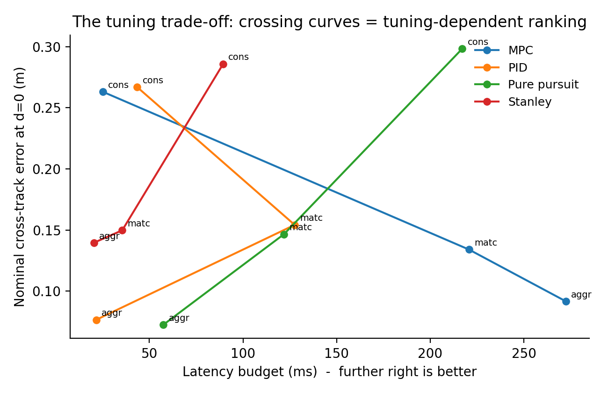

# State Delay Tolerance of Path Tracking Controllers: Effects of Tuning in the CARLA Simulator

Code and data for the paper by **Efe Demir Degim**, published in *The Ember Review*, 19 October 2026.

**Paper:** [The Ember Review](https://emberreview.org/articles/state-delay-tolerance-path-tracking-controllers/) · **Work period:** June 2025 – October 2026 · **Portfolio:** [demodgm.github.io](https://demodgm.github.io/) · **License:** MIT

**Key finding:** which controller tolerates delay best depends on how it is tuned. At matched tuning, PID held up to 128 ms of delay and Stanley to 36 ms; at conservative tuning that order reversed (Stanley 89 ms, PID 44 ms). Pure pursuit was first or tied first at all three tunings.

---

## In plain terms

A self-driving car's steering controller always acts on slightly old information about where the car is. This study feeds four common steering controllers a deliberately delayed copy of the car's position and heading in the CARLA driving simulator, and measures how much delay each one can take before it drifts off the path or starts to weave. Each controller is tested at three tuning levels, to see whether the ranking stays the same. It doesn't.

## Research question

Does the ranking of PID, Stanley, pure pursuit and an iLQR-based MPC by delay tolerance stay the same across three tuning levels: conservative, matched and aggressive?

Controller comparisons are usually run at zero delay with one set of gains. A delay comparison done that way cannot tell whether a controller tolerates delay because of its control law or because of how it happened to be tuned. Repeating the full delay sweep at three tuning levels separates the two.

## Results

**Latency budget (ms):** the delay at which a controller first crosses either failure threshold (see [Metrics](#metrics)), interpolated between sweep points. From `results/budgets.csv`.

| Controller | Conservative | Matched | Aggressive |
|---|---|---|---|
| PID | 44 | 128 | 22 |
| Pure pursuit | 217 | 122 | 58 |
| Stanley | 89 | 36 | 20 |
| MPC *(diagnostic only)* | 25 | 221 | 272 |

- At **matched** tuning (all controllers set to the same accuracy at zero delay, about 0.15 m mean cross-track error), PID and pure pursuit are effectively tied (128 and 122 ms) and Stanley is far behind (36 ms).
- At **conservative** tuning, the PID–Stanley order reverses: Stanley 89 ms, PID 44 ms.
- **Pure pursuit** is first or tied first at every tuning.
- **MPC is not ranked.** At matched tuning its tracking error *fell* as delay grew, which means its tuning was lag-dominated and the injected delay was partly cancelling that lag. Its numbers measure a mistuned controller, not its delay tolerance, so they are reported for diagnosis only.

Across the three random seeds, the budgets were 128 ms for PID, 122 ms for pure pursuit and 32–40 ms for Stanley at matched tuning, and zero-delay error varied by at most 0.001 m.



*Nominal error at zero delay against latency budget, for each controller at its three tunings. The lines cross, so the ranking depends on tuning. MPC is diagnostic only. (Figure 2 in the paper.)*

Full tables are in `results/table3.txt` (matched tuning), `table4.txt` (all three tunings) and `table5.txt` (accuracy traded for delay tolerance).

## Method

### Delay injection

The delay is applied to the **state the controller receives**, not to the actuators. Every state the simulator produces goes into a first-in, first-out buffer, and the controller reads the entry that is `n = round(d / dt)` steps old. No controller code is modified, so all four see identically constructed inputs. The harness is in `src/latency/delay.py`.

### Controllers

- **PID:** lateral PID on cross-track error for steering; longitudinal PID for speed.
- **Pure pursuit:** steers toward a speed-dependent lookahead point on the path; longitudinal PID.
- **Stanley:** heading error plus cross-track error at the front axle; longitudinal PID.
- **MPC:** a self-contained iLQR solver over a unicycle model with a 50-step (1.0 s) horizon.

### Tuning levels

Gains are searched on a grid at zero delay and then frozen for the whole delay sweep, so the sweep measures tolerance rather than retuning effort.

- **Matched:** gains chosen so all four controllers reach the same zero-delay mean cross-track error (target 0.15 m).
- **Conservative** and **aggressive:** picked from the same searched candidates, at roughly twice and half the matched error.

The frozen gains for all twelve controller × tuning combinations are in `results/gains.json`.

### Metrics

- **Cross-track error:** distance from the vehicle to the reference path, averaged over the run.
- **Steering oscillation:** standard deviation of the steering command after removing the low-frequency trend.
- **Latency budget:** the first delay at which mean cross-track error exceeds **0.50 m** (about 14% of a 3.5 m lane) **or** steering oscillation exceeds **twice** its own zero-delay value, interpolated between the two sweep points that bracket the crossing. These are operational thresholds, not stability boundaries.

### Setup

| | |
|---|---|
| Simulator | CARLA 0.9.15, synchronous mode, dt = 0.02 s (50 Hz), rendering off |
| Vehicle | `vehicle.tesla.model3`, wheelbase 2.875 m, steering limit 0.6 rad |
| State | Simulator ground truth, so the injected delay is the only error between true and observed state |
| Reference route | Town03, 460 m, recorded by driving manually with an analog gamepad (46 s, 2.7–48.8 km/h) |
| Delays | 0, 20, 40, 60, 80, 120, 160, 220, 300, 400 ms |
| Runs | 4 controllers × 3 tunings × 10 delays × 3 seeds = 360 runs |
| Software | Python 3.7.16 |

## Repository structure

```
latency-study-code_Final/latency-study/
├── src/latency/
│   ├── delay.py          # the delay-injection harness (the experimental manipulation)
│   ├── controllers.py    # PID, pure pursuit, Stanley, MPC (iLQR)
│   ├── metrics.py        # cross-track error, oscillation, latency-budget rule
│   ├── runners.py        # CARLA runner and an offline kinematic stand-in
│   ├── sweep.py          # matched tuning, then the frozen-gain delay sweep
│   ├── analyze.py        # runs.csv -> tables and figures
│   └── gamepad.py        # analog gamepad input for recording the route
├── configs/sweep.yaml    # every experimental parameter
├── data/                 # the recorded reference route
├── results/              # gains, per-run data, budgets and tables from the reported runs
├── figures/              # Figures 1-3 from the paper
├── scripts/              # route recording, self-test reference, run_experiment.sh
└── tests/                # unit tests (no CARLA needed)
```

## Reproducing the results

Requirements: a CARLA 0.9.15 server listening on port 2000, Python 3.7 or newer, and the CARLA client wheel that matches your server.

```bash
git clone https://github.com/demodgm/State-Delay-Tolerance-of-Path-Tracking-Controllers-Effects-of-Tuning-in-the-CARLA-Simulator.git
cd State-Delay-Tolerance-of-Path-Tracking-Controllers-Effects-of-Tuning-in-the-CARLA-Simulator/latency-study-code_Final/latency-study
pip install -e .
pip install <CARLA>/PythonAPI/carla/dist/carla-0.9.15-cp37*.whl

bash scripts/run_experiment.sh      # tuning, delay sweep, then tables and figures
```

The reported runs are already saved in `results/`, so the tables and figures can be rebuilt without re-simulating:

```bash
python -m latency.analyze --runs results/runs.csv --cte-threshold 0.50
```

To check the pipeline with no CARLA server (a kinematic stand-in; its output is watermarked and is not data):

```bash
python scripts/make_selftest_reference.py
bash scripts/run_experiment.sh --selftest
```

More detail, including how to record your own route, is in [`latency-study-code_Final/latency-study/README.md`](latency-study-code_Final/latency-study/README.md).

## Limitations

- Simulation only. Real actuators add jitter, saturation and dynamics that CARLA does not model.
- Ground-truth state isolates the delay, so the budgets are upper bounds on what the same controllers would tolerate with a real state estimator.
- Each run uses a fixed delay; variable delay and dropped messages are not tested.
- One vehicle, one route and one map. Budgets may shift with speed profile and path curvature.
- The MPC tuning was degenerate (lag-dominated), so its results are diagnostic only.

## Citation

```bibtex
@article{demirdegim2026statedelay,
  author  = {Demir Degim, Efe},
  title   = {State Delay Tolerance of Path Tracking Controllers: Effects of Tuning in the CARLA Simulator},
  journal = {The Ember Review},
  year    = {2026},
  month   = oct,
  url     = {https://emberreview.org/articles/state-delay-tolerance-path-tracking-controllers/}
}
```

## Acknowledgement

The controller implementations build on the framework from the *Techniques for Self-Driving Cars* course assignments. The course framework itself is not included in this repository.

## License

MIT. See [LICENSE](latency-study-code_Final/latency-study/LICENSE).
